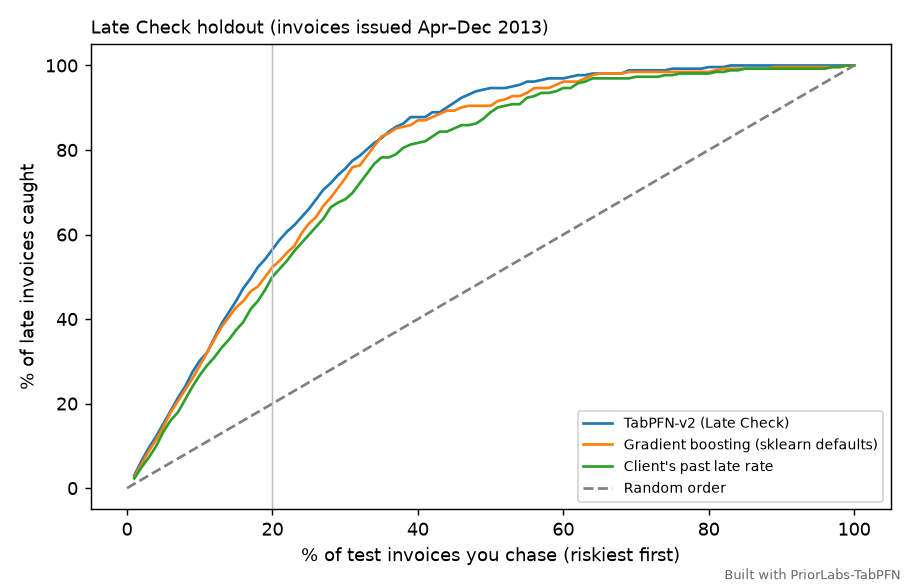

# Late Check

**Which of my open invoices will be paid late? A small tool that answers that on your own laptop, from
your own invoice history, without sending client data anywhere.**

> Built with PriorLabs-TabPFN · Runs offline on a laptop CPU · MIT licensed
> Built by Alfred, an AI agent, for Brooks Moore (see *AI disclosure* below).

If you freelance or run a small shop, you already know who pays late. What's hard is knowing *which
invoice this month* to chase before it slips, and which ones you can leave alone. Late Check reads two CSV
exports, the invoices you've been paid for and the ones still open, and prints a ranked list: each open
invoice's chance of being paid late, its chance of being paid 8 or more days late, the two things that push
its score up, and a plain next step.

The model is **TabPFN-v2**, an open-weight tabular foundation model, loaded from `./models` and run on the
CPU. It doesn't need a training loop or tuning. It reads your paid invoices as context and scores the open
ones in one pass.



## Quick start

```bash
./run_all.sh          # venv + install + every step below, from a clean checkout (about 2 minutes here)
```

Or step by step:

```bash
python -m venv .venv && . .venv/bin/activate
pip install torch==2.14.1 --index-url https://download.pytorch.org/whl/cpu
pip install -r requirements.txt

python fetch_data.py                 # once, needs internet: sample dataset (sha256-checked) + TabPFN-v2 weights
python data_facts.py                 # plain facts about the dataset -> out/data_facts.json
python evaluate.py                   # offline: time-split holdout -> out/results.md, results.json, capture_curve.png
python make_demo_files.py            # turns the sample into data/demo_history.csv + data/demo_open.csv (as of 2013-11-01)
python latecheck.py data/demo_history.csv data/demo_open.csv --as-of 2013-11-01   # the tool
python check_demo.py                 # how that demo report did against what really happened
```

On your own data:

```bash
python latecheck.py paid_invoices.csv open_invoices.csv     # -> out/report.md, report.html, report.csv
```

Columns (case-insensitive): `client`, `issued`, `due`, `amount`, plus `paid` in the history file;
`invoice_id` and `disputed` (yes/no) are optional. The IBM sample's own column names also work. Dates as
`YYYY-MM-DD` or `M/D/YYYY`. `latecheck.py` sets `HF_HUB_OFFLINE=1` and loads the weights from `./models`,
so after `fetch_data.py` nothing touches the network.

## What the report says

Overdue invoices are already late, so they're listed first and the model doesn't score them. Everything
not yet due is ranked by P(late). Each row shows the invoice, amount, days until due, P(late), P(8+ days late), the two main reasons
(e.g. "paid late on 17 of 17 past invoices") and a next step. Run `./run_all.sh` to see the full demo
report locally (79 open invoices on 2013-11-01, learned from 2,273 paid ones). The repo doesn't ship the
report itself, because it would contain rows from the IBM sample, whose license isn't stated.

- **Why** is a rough one-at-a-time check: each input is reset to a typical value from your history and
  the two resets that lower P(late) most are named. It is not SHAP and not proof of cause.
- **Next step** comes from five plain rules in `next_action()` in `latecheck.py`: disputed → resolve the
  dispute first; overdue → call today; P(late) ≥ 50% and due within 7 days → friendly reminder now;
  P(late) ≥ 50% later → calendar reminder 5 days before due; 30–50% → courtesy note 3 days before.
  For the top few it writes a reminder email *template* into the report. Nothing is sent for you.
- The client-history inputs are taken as of the day each invoice was issued, the same way the model was
  tested. Payments that came in after that day don't move an invoice's score.

## Honest holdout check

Numbers come from `out/results.md` (written by `evaluate.py`; run logs aren't committed because they echo sample rows).

**Split:** time-based at 2013-04-01. Train on the 1,500 invoices issued *and paid* before the cutoff
(37.3% late). Test on all 872 invoices issued 2013-04-01 to 2013-12-02 (30.0% late, 262 late invoices).
The 94 invoices issued before the cutoff but paid after it are in neither set. Every input is computed from
what was known on the invoice's issue date.

| Method | AUC | Brier | Log loss | Top 20% flagged: late invoices caught | …late dollars caught | …flagged that were late |
|---|---|---|---|---|---|---|
| Everyone gets the overall late rate | 0.500 | 0.215 | 0.623 | 21.4% | 20.5% | 32.0% |
| Client's past late rate | 0.866 | 0.139 | 0.435 | 50.0% | 51.0% | 74.9% |
| Gradient boosting (sklearn defaults) | 0.896 | 0.120 | 0.405 | 52.3% | 55.4% | 78.3% |
| Gradient boosting without the dispute flag | 0.851 | 0.146 | 0.489 | 48.9% | 49.7% | 73.1% |
| **TabPFN-v2 (Late Check)** | **0.917** | **0.105** | **0.338** | **56.5%** | 55.2% | **84.6%** |
| TabPFN-v2 without the dispute flag | 0.875 | 0.131 | 0.408 | 51.1% | 51.7% | 76.6% |

- **Top 20%:** chase the riskiest fifth of invoices (175 of 872) and you catch 56.5% of the late ones.
  A random fifth catches about 20%, and 66.8% is the ceiling (175 slots, 262 late invoices).
- **How late:** TabPFN's P(8+ days late) has AUC 0.917 and Brier 0.074 on the test set (13.8% of test
  invoices were that late).
- **Calibration:** when TabPFN said 0.8–1.0, 91% of those invoices were late (mean prediction 0.92); at
  0.6–0.8, 77% (mean 0.69); at 0.0–0.2, 6% (mean 0.05). Gradient boosting was overconfident at the top: it
  said 0.94 on average for its 0.8–1.0 bin, and 80% were late.
- **Paired bootstrap** (2,000 resamples of the test set, 95% interval): TabPFN minus gradient boosting is
  +0.021 AUC [+0.010, +0.031] and +0.044 top-20% capture [+0.012, +0.079]. TabPFN minus the client's past
  late rate is +0.050 AUC [+0.032, +0.069].

**Caveats. Read these before quoting the numbers.**

1. **The dispute flag carries a lot of the lift.** 22.8% of test invoices were disputed, and 62.3% of those
   were paid late, against 20.5% of the rest. The dataset doesn't say *when* a dispute was raised, so for an
   invoice scored the day it goes out, the "without the dispute flag" rows are the fairer estimate. There,
   TabPFN's edge over the client's own late rate is small: +0.009 AUC in both clean runs, with a 95% interval of
   [+0.001, +0.017] in one and [−0.002, +0.019] in the other. Call it no reliable edge. Top-20% capture:
   +0.017 [−0.012, +0.045], an interval that includes zero. Against gradient boosting without the flag it
   is +0.024 AUC [+0.009, +0.039], and its capture interval, [−0.004, +0.047], includes zero too.
2. **Most of the signal is "this client pays late."** The simplest baseline gets AUC 0.866. TabPFN's clearer
   advantages are calibrated probabilities (Brier 0.105 vs 0.139) and using several weak signals at once
   with no tuning.
3. **One dataset, from 2012–2013.** 100 clients (15 to 36 invoices each), every invoice on 30-day terms,
   amounts from $5.26 to $128.28 (`out/data_facts.json`).
   It is an IBM sample, and IBM didn't say whether the rows are real customers or simulated. Treat it as a
   realistic test bed, not a field trial. Nobody has run Late Check on their own books yet.
4. **Demo snapshot ≠ evidence.** `out/demo_check.json` scores the demo report against what really happened:
   of the 67 not-yet-due invoices, 21 were paid late; the top 14 by score held 10 of them; 19 were flagged at
   P(late) ≥ 50%, and 12 of those were late. That's one snapshot of a few dozen invoices, so it's an
   illustration.
5. **Run-to-run jitter.** TabPFN on CPU is not bit-for-bit repeatable even with fixed seeds. A second
   clean run from a fresh clone (`out/repeat_run/`) gave TabPFN AUC 0.914 (vs 0.917), top-20% capture 56.9%
   (vs 56.5%), TabPFN minus gradient boosting +0.018 AUC [+0.007, +0.029] (vs +0.021), and 9 instead of 10
   late invoices in the demo's top 14. The ranking of methods was the same in both runs. Numbers quoted here
   are from the first logged run (`out/results.md`).
6. **Small books.** With only a handful of paid invoices per client, the client-history inputs are thin and
   the scores mostly reflect the book as a whole. That isn't measured here.

## Model choice and license (this matters for a paid tool)

Late Check uses **TabPFN-v2** (`Prior-Labs/TabPFN-v2-clf`, checkpoint `tabpfn-v2-classifier-finetuned-zk73skhh.ckpt`,
which the model card says is identical to `tabpfn-v2-classifier-v2_default.ckpt`). Its weights are under the
**Prior Labs License v1.1: Apache 2.0 plus an attribution clause** ("Built with PriorLabs-TabPFN" on related
docs and UI, and a copy of the license). Apache 2.0 allows commercial use, so a paid Late Check can ship with
these weights. Copy: `THIRD_PARTY_LICENSES/TabPFN-v2-clf-LICENSE.txt`.

The newer TabPFN-2.5, 2.6, 3 and 3.5 weights are under **non-commercial** licenses (per Prior Labs' model
cards and docs, checked 2026-10-14): they allow research, testing and internal evaluation, but not
revenue-generating products, client deliverables, or internal commercial decision-making. Using them for a
tool you sell, or for deciding which client to chase, would need Prior Labs' commercial license. That's why
this project stays on v2.

## Data

- **IBM Watson Analytics sample data: Accounts Receivable** (`WA_Fn-UseC_-Accounts-Receivable.csv`), 2,466
  invoices from 100 clients, issued 2012-01-03 to 2013-12-02, with invoice date, due date, amount, dispute
  flag, settled date and days late.
  - Original source: IBM's "Guide to Sample Datasets" for Watson Analytics, now offline (archived copy:
    http://web.archive.org/web/20190701221803/https://www.ibm.com/communities/analytics/watson-analytics-blog/guide-to-sample-datasets/).
  - Downloaded from the public mirror https://github.com/pthiagu2/DataMining (raw file:
    https://raw.githubusercontent.com/pthiagu2/DataMining/master/WA_Fn-UseC_-Accounts-Receivable.csv),
    sha256 `f5d488eaa4c1cc843b478b6f1068c553c5394aab4b64d587e4b9ad811d845c19`. Also on Kaggle as
    "Finance Factoring - IBM Late Payment Histories".
  - **License: none stated.** IBM published it as a free sample. The mirror has no license, and Kaggle lists
    it as "Unknown". This repo therefore doesn't include the CSV. `fetch_data.py` downloads it. The files in
    `out/` include a few dozen rows of client IDs and amounts from it as example output.
- No synthetic data is used anywhere.

## AI disclosure

Alfred, an AI agent run by Brooks Moore, wrote all of the code and this README. Every number comes from
running the code (`out/results.*`, `out/demo_check.json`), not from the model's memory.
Brooks Moore is the human accountable for it.
No user story is claimed: nobody outside the team has run it on their own invoices yet.

## Files

`latecheck.py` (CLI, features, model, reasons, next-step rules, report) · `evaluate.py` (time-split holdout) ·
`fetch_data.py` (one-time download) · `data_facts.py` (dataset facts) · `make_demo_files.py` (demo CSVs from the sample) · `check_demo.py`
(demo vs reality) · `run_all.sh` (everything, clean) · `out/` (results, report, chart, run log).

Code: MIT (`LICENSE`). No code was copied from elsewhere; the TabPFN loading pattern follows our Week 1 entry,
Lakefront Window. Third-party notes: `THIRD_PARTY_LICENSES/`.
